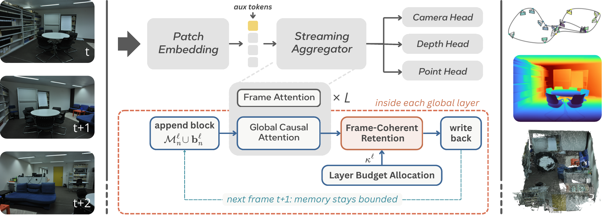

# FLCL: Frame-Level Coherent Leaving

**Constant-Memory In-Layer Retention for Streaming Geometry**

---

**TL;DR:** FLCL is a *training-free* retention rule that turns a causal, KV-cached visual geometry transformer into a **constant-memory** streaming reconstructor. Inside every global-attention layer it treats each frame's key-value block as an indivisible unit and, when the layer's budget overflows, keeps the first frame, the most recent frame, and the middle frames that best **cover the key space** (farthest-first selection over normalized mean-key signatures). No extra parameters, no external memory manager, FlashAttention-compatible.

<p align="center">
  
</p>

## Overview

Streaming geometry models such as StreamVGGT cache the keys and values of every past frame, so memory and per-step compute grow without bound. Prior bounded-memory methods either evict individual tokens (which shreds past views into incoherent fragments) or keep whole frames through an external tiered memory driven by decoded geometry and tuned thresholds.

FLCL keeps the advantages of whole-frame memory with none of that machinery:

* **Whole frames as the unit of memory.** A frame is kept in full or dropped in full, so every retained view remains a coherent observation.
* **Coverage, not saliency.** Each cached frame is summarized by the normalized mean of its keys (already produced by the forward pass). Middle frames are chosen by farthest-first selection so the retained set spans the scene instead of collapsing onto near-duplicates.
* **In-layer, in-place.** Retention runs inside each attention layer on that layer's own KV cache. Memory is bounded by a single total budget Θ (default ≈ 8 frames per layer) for arbitrarily long streams.

FLCL is evaluated on 7-Scenes, NRGBD, ETH3D, Long3D (3D reconstruction), Bonn and KITTI (video depth) and TUM RGB-D (camera pose), and it matches or surpasses more complex bounded-memory baselines, with the largest margins on long streams.

## Installation

```bash
git clone https://github.com/VAISR/FLCL.git
cd FLCL

conda create -n flcl python=3.11 cmake=3.14.0
conda activate flcl
pip install -r requirements.txt
conda install 'llvm-openmp<16'
```

### Checkpoint

FLCL is training-free and runs on the public StreamVGGT weights. Download `checkpoints.pth` from
[Hugging Face](https://huggingface.co/lch01/StreamVGGT/) or
[Tsinghua Cloud](https://cloud.tsinghua.edu.cn/d/d6ad8f36fcd541bcb246/) and place it at `ckpt/checkpoints.pth`.

### Datasets

Symlink or copy the benchmarks under `src/data/` (see [`src/data/README.md`](src/data/README.md) for the expected layout). Data preparation follows the evaluation guides of [MonST3R](https://github.com/Junyi42/monst3r/blob/main/data/evaluation_script.md), [CUT3R](https://github.com/CUT3R/CUT3R/blob/main/docs/eval.md) and [StreamVGGT](https://github.com/wzzheng/StreamVGGT).

## Evaluation

All launchers default to the FLCL setting used in the paper:

```
--model_name OVGGT --ssc_score frame_cov --dap off --budget_mode uniform --max_token_budget 200000
```

### 3D reconstruction (7-Scenes / NRGBD / ETH3D)

```bash
# 7-Scenes, short streams (200 frames, keyframe stride 2)
TAG=7s_200   MAX_FRAMES=200  bash scripts/eval/run_mv_recon.sh
# 7-Scenes, long streams (1000 frames, every frame)
TAG=7s_1000  MAX_FRAMES=1000 KF_EVERY=1 bash scripts/eval/run_mv_recon.sh
# NRGBD
TAG=nrgbd_100 DATASET=NRGBD MAX_FRAMES=100 bash scripts/eval/run_mv_recon.sh
TAG=nrgbd_500 DATASET=NRGBD MAX_FRAMES=500 KF_EVERY=1 bash scripts/eval/run_mv_recon.sh
# ETH3D (every frame)
TAG=eth3d DATASET=eth3d KF_EVERY=1 bash scripts/eval/run_mv_recon.sh
```

The per-sequence metrics and the final `mean` line (Acc / Comp / NC and peak GPU memory) are written to `eval_results/mv_recon_<TAG>/<dataset>/logs_all.txt`. Use `SCENE=chess MAX_FRAMES=20` for a quick smoke test. Long sequences fuse large point clouds on the CPU; pass `EXTRA="--voxel_size 0.01"` if host RAM is limited.

### Long3D

```bash
cd src
python eval/mv_recon/launch_long3d.py --weights ../ckpt/checkpoints.pth \
    --root ./data/Long3D --output_dir ../eval_results/long3d --kf_every 1
```

### Video depth (Bonn / KITTI)

```bash
cd src
bash eval/video_depth/run.sh      # edit `datasets=(...)` inside for bonn_500 / kitti_500 etc.
```

### Camera pose (TUM RGB-D)

```bash
cd src
bash eval/pose_evaluation/run.sh  # edit `datasets=(...)` inside for tum_100 ... tum_500
```

### Throughput and peak memory

```bash
bash scripts/bench/run_bench_fps_vram.sh                     # full 10..1000-frame grid on 7-Scenes chess
FRAMES_LIST=100,500,1000 bash scripts/bench/run_bench_fps_vram.sh
python scripts/bench/plot_fps_vram.py --csv eval_results/bench/fps_vram.csv --outdir eval_results/bench
```

## Flags

The flags below are accepted by `eval/mv_recon/launch.py`, `eval/video_depth/launch.py` and `eval/pose_evaluation/launch.py` (pass them through `EXTRA="..."` when using the driver script).

| Flag | Default | Meaning |
|---|---|---|
| `--max_token_budget Θ` | `200000` | Total KV budget over all global layers (≈ 8 frames/layer at 518×392). |
| `--ssc_score` | `frame_cov` | Retention rule. `frame_cov` = FLCL (whole-frame, farthest-first coverage). Ablations: `frame_attn`, `frame_hybrid`, `frame_random`, `token_cov`, `ffn`, `attn`, `attn_relevance`. |
| `--frame_keep_anchor on/off` | `on` | Always keep the first frame (world anchor). |
| `--frame_keep_recent on/off` | `on` | Always keep the most recent frame. |
| `--frame_random_seed` | `0` | Seed for `--ssc_score frame_random`. |
| `--budget_mode uniform/adaptive` | `uniform` | Per-layer budget split. `uniform` = Θ/L (θ = 1). `adaptive` = diversity-driven softmax (paper Eq. 9). |
| `--budget_temperature θ` | `0.5` | θ ∈ [0, 1] for `adaptive`; θ → 1 is uniform, smaller θ concentrates the budget. |
| `--dap on/off` | `off` | Dynamic anchor protection from OVGGT; must stay `off` for the `frame_*` rules. |

### Reproducing the ablations

All ablations use 7-Scenes at 1000 frames (`MAX_FRAMES=1000 KF_EVERY=1`) with the default budget.

| Paper table | `EXTRA=` |
|---|---|
| Granularity: token-level attention / FFN / coverage | `--ssc_score attn` / `--ssc_score ffn` / `--ssc_score token_cov` |
| Granularity: frame-level attention / coverage+attention | `--ssc_score frame_attn` / `--ssc_score frame_hybrid` |
| Layer allocation temperature θ | `--budget_mode adaptive --budget_temperature {0.1,0.25,0.5,0.75,1.0}` |
| Total budget | `--max_token_budget {100000,200000,400000,600000}` |
| Composition: random / + anchors / + coverage | `--ssc_score frame_random --frame_keep_anchor off --frame_keep_recent off` / `--ssc_score frame_random` / (default) |

## Demos

```bash
# Interactive 3D visualization of a streamed image folder (viser)
python demo_viser.py --seq_path path/to/image_sequence --frame_interval 10

# Web UI (gradio)
pip install -r requirements_demo.txt
python demo_gradio.py

# ETH3D single-scene demo: depth maps, fused point cloud and camera trajectory
python scripts/demo/eth3d_demo.py --scene kicker
python scripts/demo/plot_camera_frustums.py
```

## Code map

```
src/flcl/layers/attention.py      frame_eviction(): the FLCL retention rule (mean-key signatures,
                                  farthest-first coverage, anchor/recent pins) and the ablation modes
src/flcl/models/aggregator.py     per-layer budget allocation (uniform / diversity-driven softmax)
src/flcl/models/ovggt.py          model wrapper; injects the retention settings into every global block
src/eval/                         evaluation harnesses (mv_recon, video_depth, pose_evaluation)
scripts/eval, scripts/bench       single-GPU drivers for the benchmarks and the FPS/VRAM study
```

FLCL is implemented on top of our earlier [OVGGT](https://github.com/VAISR/OVGGT) codebase (ECCV 2026), so the model class and the `--model_name OVGGT` option keep that name; the FLCL behaviour is selected by the default flags listed above.

## Acknowledgements

This code builds on the following excellent repositories:
[DUSt3R](https://github.com/naver/dust3r),
[MonST3R](https://github.com/Junyi42/monst3r),
[Spann3R](https://github.com/HengyiWang/spann3r),
[CUT3R](https://github.com/CUT3R/CUT3R),
[VGGT](https://github.com/facebookresearch/vggt),
[Point3R](https://github.com/YkiWu/Point3R),
[StreamVGGT](https://github.com/wzzheng/StreamVGGT),
[TTT3R](https://github.com/Inception3D/TTT3R),
[Evict3R](https://github.com/soroush-mim/evict3r),
[InfiniteVGGT](https://github.com/AutoLab-SAI-SJTU/InfiniteVGGT),
[OVGGT](https://github.com/VAISR/OVGGT).
Many thanks to their authors.

## Citation

```bibtex
(to be added)
```

## License

This repository inherits the [CC BY-NC-SA 4.0](LICENSE) license of StreamVGGT and VGGT-derived code. Third-party components (CroCo, DUSt3R) keep their own licenses in their subdirectories.
